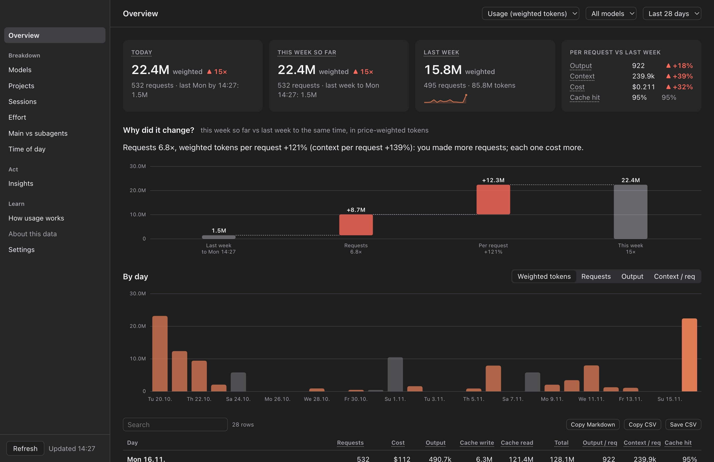
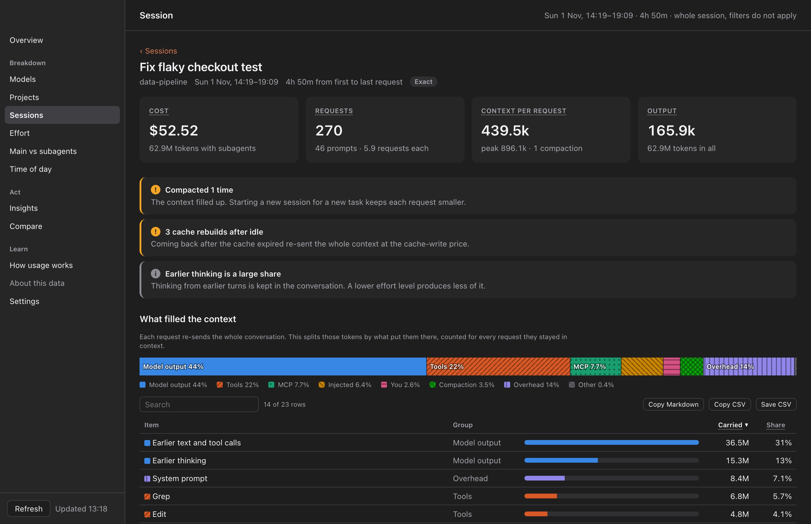
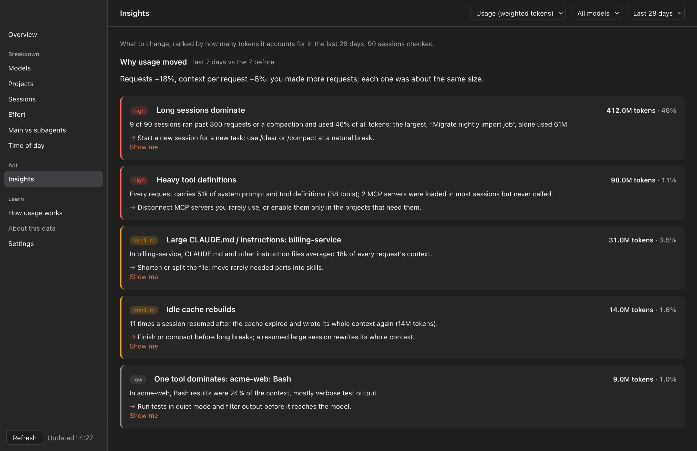

# Claude Usage Analytics

See where your Claude Code tokens go on your Mac: by day, model, project,
session, prompt and tool, and whether this week is heavier than last.



Claude Desktop shows how much of your plan's limit you have used. It does not
show what used it. Claude Code already logs the token usage of every API
response in its transcripts under `~/.claude/projects`; this app reads those
logs into a local index and explains them.

The first thing it shows is usually surprising: about 98% of tokens are cache
reads. Every request re-sends the whole conversation, so a long session costs
more per request with every turn, and the system prompt and every tool
definition ride along each time. The app splits each session's context by what
put it there, so you can see which tool, MCP server, instruction file or habit
is behind the number.

All screenshots in this README use made-up demo data.

## What it shows

| View           | What you learn                                                                                                                                  |
| -------------- | ----------------------------------------------------------------------------------------------------------------------------------------------- |
| **Overview**   | Today and this week against last week at the same time of day, why it changed (more requests, or heavier ones), cost per day.                  |
| **Breakdowns** | Models, projects (worktrees fold into their repo), sessions, effort level, main thread against subagents, hour of day and a 13-week calendar.   |
| **Session**    | What filled the context, item by item; the context size over the session with compactions and cache rebuilds marked; each prompt and what it set off; the largest single items; what is sent with every request, with MCP servers that were loaded but never called. |
| **Insights**   | Ranked findings, each with the tokens it accounts for and one thing to change: long sessions, heavy tool definitions, large `CLAUDE.md` files, oversized tool results, idle cache rebuilds. |
| **Compare**    | Export a summary with no paths, titles, prompts or tool arguments, and line colleagues' files up week by week.                                  |
| **Menu bar**   | Today compared with your own usual day ("1.4× usual"), or the active session's context, weighted or raw tokens, or API cost. The menu spells out today and this week against usual and the active session's context and compactions. Optional notifications for a large context, a cache rewrite after a pause, or an unusually heavy day. |





Amounts can be shown as **price-weighted tokens**, **cost** or **raw tokens**.
Weighted tokens are the default: raw tokens are dominated by cheap cache reads,
and dollars mean nothing on a subscription plan. Cost is one click away and
uses a dated table of Anthropic's published API prices and matches Claude
Code's own cost estimate for sessions recorded by current Claude Code. It is
what the tokens would cost on the API, not what a subscription bills.

## Install

The app is not signed with an Apple Developer ID yet, so whichever way you
install it, macOS will refuse to open it until the quarantine flag is cleared.
One command does that; it is included in each path below.

### Homebrew (recommended)

```bash
brew tap jravas/tap
brew install --cask claude-usage-analytics
xattr -dr com.apple.quarantine "/Applications/Claude Usage Analytics.app"
```

Upgrades are `brew upgrade --cask claude-usage-analytics` followed by the same
`xattr` line. The cask definition lives in
[homebrew/Casks](homebrew/Casks/claude-usage-analytics.rb).

### Download the DMG

Grab the `.dmg` for your chip from the
[releases page](https://github.com/jravas/claude-usage-analytics/releases),
drag the app to Applications, then clear the flag once:

```bash
xattr -dr com.apple.quarantine "/Applications/Claude Usage Analytics.app"
```

Without that step, macOS 15 and later shows "Apple could not verify this app"
and offers no way through from the dialog. The alternative is System Settings
→ Privacy & Security → Open Anyway.

### Build from source

Apps built locally are never quarantined.

```bash
git clone https://github.com/jravas/claude-usage-analytics.git
cd claude-usage-analytics
cargo install tauri-cli --version '^2' --locked
cd crates/app && cargo tauri build
open ../../target/release/bundle/macos/Claude\ Usage\ Analytics.app
```

Requires Rust stable and Xcode command line tools. There is no Node toolchain.

### Why no Developer ID

Signing and notarization need an Apple Developer Program membership. The
release workflow already supports it: set the `APPLE_*` repository secrets
listed in [.github/workflows/release.yml](.github/workflows/release.yml) and
tagged builds come out signed and notarized, with no quarantine step for
anyone. Until then, releases are ad-hoc signed.

## Privacy

Read-only and offline. The app reads Claude Code's transcripts and Claude
Desktop's session index, and stores token counts, model, effort, timestamps,
project folder, branch and session titles in a local SQLite index. The session
page re-reads one transcript to measure the size of what was in context; it
never stores or shows message text, prompts or tool output. The app makes no
network requests.

The index lives in
`~/Library/Application Support/digital.prototyp.claude-usage-analytics/index.sqlite`.
Delete it to rebuild from the transcripts still on disk. Rows stay in the
index after their transcript is deleted, so history survives a cleanup with
[Claude Storage Cleaner](https://github.com/jravas/claude-storage-cleaner).

## What it cannot see

- Plan-limit percentages: they are not stored locally, and the app never
  approximates them.
- claude.ai chats, other computers, and other people (unless they share a
  summary file with you).

## How it counts

- One API response is written to the transcript once per content block, and
  each line repeats the same `usage`. Rows are keyed on `message.id` +
  `requestId`, so each response counts once. Counting lines roughly doubles
  the totals.
- **Context per request** is input + cache writes + cache reads: what the
  model read for that request. **Total tokens** adds output.
- A session's context is split exactly when Claude Code recorded request
  snapshots (recent versions): each request's message list is rebuilt from
  them. Older transcripts are split by the order and size of what was added,
  and are marked _Estimated_.
- Days and hours are in local time.

## Command line

The same engine ships as a CLI:

```bash
cargo build --release -p usage-core
./target/release/usage summary                    # this week against last week
./target/release/usage daily --weekdays --model opus
./target/release/usage by project --days 7
./target/release/usage session <id> --turns --pieces
./target/release/usage insights --days 14
./target/release/usage export --summary me.json   # shareable, no private text
./target/release/usage compare me.json colleague.json
./target/release/usage cost-check                 # price table vs Claude Code's own estimate
```

`usage --help` lists every command; `--json` prints JSON.

## How it works

```
crates/core   usage-core: transcript parser, SQLite index, cost model,
              session analyzer, insights, sharing, and the `usage` CLI
crates/app    usage-app: Tauri 2 shell, menu bar item, file watcher,
              notifications
ui/           index.html, styles.css and plain JS, embedded at build time
```

1. A file watcher on `~/.claude/projects` reads only the bytes appended since
   the last read, so the index stays current within a second or two. A full
   first read of several gigabytes of transcripts takes a few seconds.
2. Each request is priced once from the price table, and again when the table
   changes.
3. The session analyzer streams one transcript (they reach hundreds of
   megabytes) and keeps a ledger of everything in context: each piece's size
   and the requests it stayed for, until a compaction.

## Development

```bash
cargo test --workspace
cd crates/app && cargo tauri dev
```

The UI can be previewed in a browser with mock data; see
[CONTRIBUTING.md](CONTRIBUTING.md). `scripts/screenshots.sh` regenerates the
screenshots above from synthetic data only. Changes are tracked in
[CHANGELOG.md](CHANGELOG.md), and [docs/PLAN.md](docs/PLAN.md) has the
roadmap.

## License

[MIT](LICENSE)
